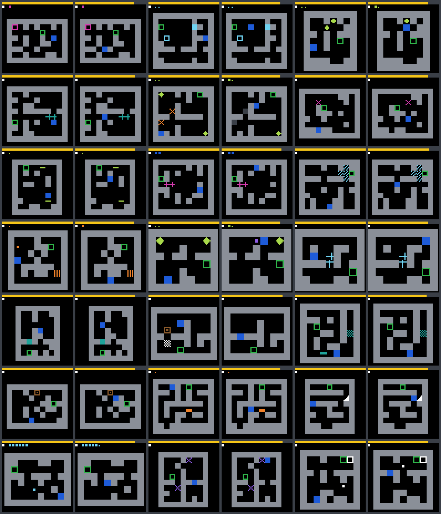

# Game Factory: can an agent figure out a game nobody explained?

An RL environment for the AfterQuery challenge at Junction 2026. The agent plays small grid games it has never seen,
with no rules given. One command runs the judging protocol: `make judge`.



## What the agent does

Each turn the agent sees the screen (a 64×64 image, also sent as a grid of colour numbers) and picks a move: up,
down, left, right, or RESET to restart the level. Nobody tells it the goal, the rules or what the colours mean. It
has to find out by moving and watching what changes.

A game has 8 levels in the judging set. Level 1 is a plain maze. Each later level adds one hidden mechanic: ice you
slide on, plates that open gates, keys and doors, a tile that rotates the map, a second figure that copies your
moves. The last level combines them. A bar at the top of the screen shows how many moves are left.

## Why it is hard

To play well, the agent has to guess what a new object does, test the guess in a few moves, remember the answer,
plan a route that uses it, and notice when the next level changes the rules. Frontier models mostly fail by
walking into walls over and over, by holding on to a wrong guess, or by missing what a new level added.

Failures come from the agent's own choices. Everything it needs is on screen. Every level is checked solvable by
exact search, and every mechanic in a level changes its solution. Games are generated from a seed,
so there are always fresh games that no model saw in training.

## How it is scored

Per level: if solved, the shortest possible number of moves divided by the moves used (at most 1); if not solved,
0. The game's score is the mean over its levels. Every action counts, RESET included.

So the shortest-path reference scores 1.000, doing nothing scores 0.000, and stopping after level 1 of 8 scores
0.125. The game container computes the score and a separate verifier container writes it to
`/logs/verifier/reward.txt`. The agent cannot reach either one. We tried 10 ways to cheat the reward from the
agent's seat; all scored 0 or were blocked ([docs/JUDGING.md](docs/JUDGING.md)).

## Run it

You need Python 3.11+, Docker and Harbor 0.26.0.

```bash
git clone <repo> junction-2026 && cd junction-2026
make setup && . .venv/bin/activate
uv tool install harbor==0.26.0
cp .env.example .env          # add your API keys (docs/KEYS.md)
```

The Harbor tasks are committed: `harbor/eval-v2/` (30 games, 8 levels, 3 rules held out from training: the judging
set) and `harbor/eval-v1/` (30 easier games, 6 levels).

```bash
make judge                                     # reference, do-nothing and stop-early on eval-v2 game 1 (no model cost)
make judge MODEL=gemini/gemini-4-argon K=3     # plus 3 OpenCode runs in parallel (2 h cap each)
make judge TASK=harbor/eval-v2/<task> MODEL=anthropic/claude-sonnet-5-5 K=3
```

`MODEL` is any OpenCode selector (`anthropic/...`, `gemini/...`, `openai/...`), or one of the providers in
[arena/opencode-models.json](arena/opencode-models.json). `make judge` prints a summary table at the end.

### Running `harbor run` by hand

```bash
TASK=harbor/eval-v2/gridworld-s910000-d4-l8-f71ee29e
harbor run -p "$TASK" -a oracle                                   # reference: 1.000
harbor run -p "$TASK" -a nop                                      # do nothing: 0.000
harbor run -p "$TASK" -a oracle --ae ORACLE_STOP_AFTER_LEVELS=1   # stop early: 0.125
set -a; . ./.env; set +a
harbor run -p "$TASK" -a opencode -m gemini/gemini-4-argon -k 3 \
  --ae 'GOOGLE_GENERATIVE_AI_API_KEY=${GEMINI_API_KEY}'
```

OpenCode runs inside the agent container, so the API key has to reach that container. If it doesn't, OpenCode stops
at once with `ProviderAuthError ... API key is missing` and the task scores 0.

| Model | What to pass |
|---|---|
| `anthropic/<model>` | Nothing extra. Harbor forwards `ANTHROPIC_API_KEY` from your shell. |
| `gemini/<model>` | `--ae 'GOOGLE_GENERATIVE_AI_API_KEY=${GEMINI_API_KEY}'`. Exporting the variable in your shell is not enough. |
| `openai/<model>` | Not tested. If you get `ProviderAuthError`, add `--ae 'OPENAI_API_KEY=${OPENAI_API_KEY}'`. |
| Verda and Featherless models | `--ak "opencode_config=..."` plus the key: see [arena/HARBOR.md](arena/HARBOR.md). |

Keep the single quotes: Harbor fills in `${...}` and stores only the template, never the key. The agent can reach
only the game and the common model APIs. For another API host, add `--allow-agent-host <host>`
(`EXTRA="--allow-agent-host <host>"` with `make judge`).

`python -m server mcp` is for local development and the demo, not for judging.

## Results

Harbor + OpenCode on eval-v2 game 1 (shortest solution: 187 moves). Full logs and trajectories:
[harbor/run-logs/](harbor/run-logs/README.md).

| Run | Levels | Reward |
|---|---:|---:|
| Reference (`oracle`) | 8/8 | 1.000 |
| Stop early after level 1 | 1/8 | 0.125 |
| Do nothing (`nop`) | 0/8 | 0.000 |
| Gemini 4 Carbon, 3 runs, 60-min cap | 7/8 each | 0.762 mean |
| Gemini 3.8 Flash, 3 runs, 60-min cap | 6/8, 2/8, 2/8 | 0.322 mean |
| Gemini 4 Argon, 3 runs, 60-min cap | 2/8 each | 0.247 mean (OpenCode crashed on a Gemini API error) |

No model has won this game yet. Shorter capped runs of Kimi K3.1, DeepSeek 4.1 Flash, Claude Haiku 5.5,
DeepSeek V3.2, Nemotron and GLM 5.3 are in the same folder; they show each model plays and gets graded.

**Humans vs models on eval-v2** (snapshot of 1,006 recorded runs, 2026-11-14; humans played each game once):

| Player | Harness | Games | Levels solved | Score | 95% CI |
|---|---|---:|---:|---:|---|
| Shortest path | - | 20 | 160/160 | 1.000 | - |
| Humans, first try | browser | 20 | 150/160 | 0.693 | 0.632-0.749 |
| Gemini 4 Argon | h1 | 7 | 36/56 | 0.494 | 0.372-0.621 |
| Gemini 3.1 Pro | h2 | 4 | 20/32 | 0.439 | 0.242-0.636 |
| Kimi K3.1 Pro | h2 | 4 | 20/32 | 0.398 | 0.150-0.590 |
| Gemini 3.8 Flash | h1 | 8 | 3/64 | 0.028 | 0.004-0.060 |
| Random, stop early, do nothing | - | 20 each | 0 | 0.000 | - |

On every game both played, humans scored higher than each model. h1 sends one fresh request per turn; h2 keeps the
whole conversation and the model's reasoning, the way labs benchmark. Score definitions:
[analysis/METRICS.md](analysis/METRICS.md).

## Training on the games

There is a separate training split (different seeds, some rule combinations held out). We post-trained Qwen3.5
models on it. On 100 simulated rover missions with scrambled controls, Qwen3.5-4B went from 41 to 54 completed
missions after two rounds of RL on our games (p = 0.019). See [posttrain/](posttrain/README.md),
[bench/](bench/PROTOCOL.md) and [experiments/edge_rover/](experiments/edge_rover/README.md).

## Tests

```bash
make test                                   # Python tests
make smoke                                  # starts a local server and plays a game to a win
cd web && npm install && npm run build      # web app
python -m analysis check-claims --derived data/fixtures/derived
```

## Repository layout

| Folder | What it holds |
|---|---|
| `engine/` | Game generator, the 18 mechanics, solver, train/eval splits ([rules/CATALOG.md](rules/CATALOG.md)) |
| `harbor/` | The committed Harbor tasks (`eval-v1`, `eval-v2`) and run logs |
| `arena/` | Harbor task exporter, model harnesses (h1, h2), baselines, sweeps ([arena/HARBOR.md](arena/HARBOR.md)) |
| `server/` | Game server, run recorder, live feed |
| `analysis/` | Leaderboards, metrics, failure analysis |
| `web/` | Web app: play, gallery, replays, leaderboards |
| `posttrain/`, `bench/` | Post-training and the benchmark protocol |
| `contracts/` | Shared schemas, palette, API spec |
| `docs/` | [Submission sheet](docs/SUBMISSION.md), [judging details](docs/JUDGING.md), [API keys](docs/KEYS.md), [business case](docs/BUSINESS.md), [pitch deck](docs/story-deck/index.html) ([PDF](docs/story-deck/Game-Factory-Pitch-Deck.pdf)) |

## Tools we used

- **Verda:** the CPU VM that hosts the live site and game server ([API_URL](API_URL)); A100, H100 and B200 GPUs for
  training and benchmarks; managed inference for Kimi K3.1 and DeepSeek 4.1 Flash.
- **NVIDIA Nemotron:** Nemotron 3.5 Super VL on the organisers' endpoint. Through Harbor + OpenCode it scored 0.067
  on average over three runs of a dev game.
- **Gemini API:** the frontier models in the results above.
- **Modal:** H100s for GRPO runs, and an endpoint serving Gemma 4 E4B.
- **Codex:** the first version of the rover experiment and work on the pitch deck.

Endpoints and keys: [arena/models.yaml](arena/models.yaml), [docs/KEYS.md](docs/KEYS.md).
